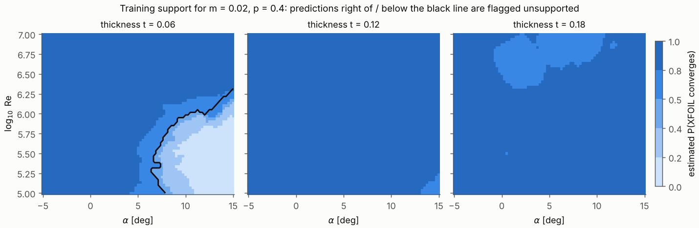

# Predictions

## What is predicted

For a NACA 4-digit section with maximum camber `m`, camber position `p` and thickness `t` (fractions of chord), chord
Reynolds number `Re` and angle of attack `alpha` (degrees), NeuralNACA predicts what **XFOIL 6.99** computes with
free transition (`n_crit = 9`, transition location free on both surfaces), Mach 0, 279 panels and a cold start:

* `CL`: lift coefficient,
* `CD`: drag coefficient (viscous: friction plus pressure drag),
* `CM`: pitching-moment coefficient about the quarter chord, nose-up positive.

The model learns XFOIL's answers; it is not an independent CFD solver, and any error XFOIL makes (near stall, for
example) is inherited. See [Limitations](../limitations.md).

## Inputs

```text
NeuralNACA.predict(airfoil=None, *, alpha, Re, m=None, p=None, t=None, on_domain_error="warn", return_members=False)
```

* `airfoil`: a designation such as `"2412"`, `"NACA 2412"`, `"naca2412"` or `"NACA-2412"`. Alternatively pass
  `m`, `p`, `t` (non-integer sections are fine). `p` is ignored when `m == 0`.
* `alpha`, `Re` and `m, p, t` broadcast against each other with NumPy rules, so `alpha` can be a column vector and
  `Re` a row vector to get a 2-D table:

```python
import numpy as np
from neuralnaca import NeuralNACA

model = NeuralNACA.pretrained()
out = model.predict("4412", alpha=np.arange(-4, 13)[:, None], Re=np.array([2e5, 1e6, 5e6]))
out["CL"].shape        # (17, 3)
```

## Outputs

| key | meaning |
|---|---|
| `CL`, `CD`, `CM` | ensemble mean (for drag: geometric mean, `CD = exp(mean(ln CD))`) |
| `CL_std`, `CM_std` | standard deviation across the 5 ensemble members |
| `lnCD_std` | standard deviation of `ln CD` (a relative drag spread: 0.01 ≈ 1 %) |
| `CD_std` | `CD * lnCD_std` |
| `in_domain` | condition inside the validated box (below) |
| `xfoil_convergence` | estimated probability that XFOIL converges at this condition |
| `supported` | `in_domain`, `xfoil_convergence >= 0.5` and `CD` within the range of the training data |
| `members` | only with `return_members=True`: per-member `[CL, ln CD, CM]`, shape `(5, ..., 3)` |

## The validated domain

| parameter | range |
|---|---|
| maximum camber `m` | 0 to 0.08 (NACA first digit 0-8) |
| camber position `p` | 0.2 to 0.7 (second digit 2-7; irrelevant for symmetric sections) |
| thickness `t` | 0.06 to 0.18 (last two digits 06-18) |
| Reynolds number | 1e5 to 1e7 |
| angle of attack | -5 to 15 deg |

Every reported accuracy number refers to this box. Outside it, the model extrapolates and a `DomainWarning` is issued.
`neuralnaca.DEFAULT_DOMAIN.contains(m, p, t, Re, alpha)` performs the same check.

## Knowing when not to trust a prediction

Two independent signals are provided.

**1. Training support (`supported`, `xfoil_convergence`).** XFOIL does not converge everywhere inside the box; the
main region is deep stall of thin sections at low Reynolds number (see the map below). The model never saw data
there, and its predictions there are unconstrained extrapolations. Drag in particular can become absurd: for example
`C_D > 1` for NACA 0006 at Re = 1e5 and 15 degrees. Such conditions are flagged:

* `xfoil_convergence` is a distance-weighted k-nearest-neighbour vote (k = 10) over the converged and non-converged
  runs of the training set. It costs no extra XFOIL runs.
* `supported` additionally requires the predicted `CD` not to exceed the largest drag in the converged training data
  (0.156).
* an `UnsupportedWarning` is raised for such conditions inside the domain.



On held-out data the flag catches 36-47 % of the conditions where XFOIL fails and wrongly flags well under 1 % of
those where it converges. XFOIL's failures are partly random, so no estimate based on neighbouring conditions can
catch them all. Details are in [Results](../results.md#knowing-when-not-to-trust-a-prediction).

**2. Ensemble spread (`CL_std`, `lnCD_std`, `CM_std`).** The five members agree closely where data are dense and
disagree where the model is uncertain. On the held-out test sets the spread's rank correlation with the actual error
is 0.58-0.69, and 15-19 of the 20 largest \(C_L\) errors of each replication have a spread in the top 5 % (table in
[Results](../results.md#knowing-when-not-to-trust-a-prediction)).
The spread is a *ranking* signal, not a calibrated confidence interval. A practical rule: treat predictions whose
`CL_std` is far above the typical value for nearby conditions with suspicion.

```python
out = model.predict("8412", alpha=-4.0, Re=1.2e5)     # high camber, low Re, negative incidence: a hard corner
print(out["CL"], out["CL_std"], out["supported"])
```

## Gradients

The panel method, the features and the network are all PyTorch operations, so derivatives with respect to the
inputs are available through autograd. Build the inputs yourself with
`neuralnaca.model.to_tensors` / `neuralnaca.model.make_inputs` and call the network directly; see the source of
`neuralnaca.training.physics_residuals` for a worked example (it differentiates `CL` with respect to `alpha` and
`ln CD` with respect to `ln Re`).

## Performance

A prediction costs one small panel solve per *distinct* airfoil (memoised per model instance) plus a forward pass of
the 5-member ensemble. Polars and batches of conditions on the same section are therefore cheap; thousands of
distinct sections cost a few milliseconds each on a CPU.
