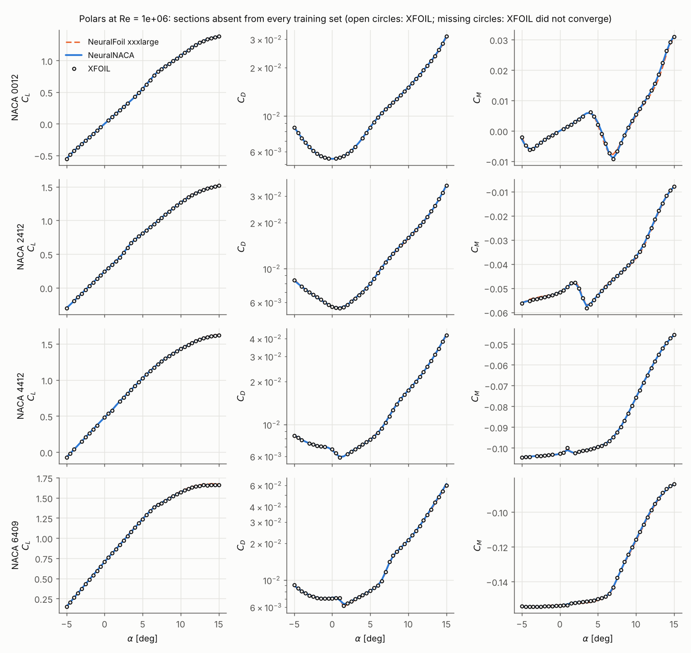

# NeuralNACA

**A physics-embedded neural surrogate for NACA 4-digit airfoil polars that matches XFOIL more closely than
NeuralFoil, trained on 0.052 % of NeuralFoil's XFOIL runs.**

```python
import neuralnaca
aero = neuralnaca.get_aero("NACA 2412", alpha=4.0, Re=1e6)
```

NeuralNACA predicts lift, drag and pitching moment as XFOIL 6.99 computes them (free transition,
N<sub>crit</sub> = 9, Mach 0) for NACA 4-digit sections with 0-8 % camber and 6-18 % thickness, at Reynolds numbers
from 10<sup>5</sup> to 10<sup>7</sup> and -5° to 15° incidence.

<div class="grid cards" markdown>

* **Physics where it is known.** A differentiable panel method gives the inviscid lift and moment; the architecture is
  exactly mirror-symmetric; a flat-plate prior anchors the drag. A small ensemble learns only the viscous correction.
  → [Method](method.md)
* **A careful comparison.** Five independent replications, all eight NeuralFoil sizes, paired bootstrap intervals,
  five definitions of the XFOIL ground truth, ablations and a data-efficiency curve.
  → [Benchmark protocol](benchmark.md), [Results](results.md)
* **Honest about failure.** Where XFOIL itself fails, predictions are flagged; where the model is weak, it says so.
  → [Limitations](limitations.md)
* **Reproducible by construction.** Data, models and results ship with checksums; every number in these pages is
  generated and tested; `neuralnaca reproduce` re-derives them at three depths.
  → [Reproducing the results](reproducibility.md)

</div>

## The result in one table

--8<-- "docs/results/headline.md"

NeuralNACA is a **specialist** (one airfoil family, one flow model, a bounded domain) compared with a **generalist**.
Its advantage comes mainly from modelling the exact NACA geometry, which NeuralFoil approximates with a Kulfan fit
to which XFOIL is surprisingly sensitive (see [Results](results.md#summary)). It is not a general replacement for
NeuralFoil, and all errors are relative to XFOIL, not to experiments.



## Where to start

* Want predictions? → [Installation](installation.md), then [Quick start](quickstart.md).
* Want to judge the claim? → [Benchmark protocol](benchmark.md) → [Results](results.md) → [Limitations](limitations.md).
* Want to check it yourself? → [Reproducing the results](reproducibility.md).
