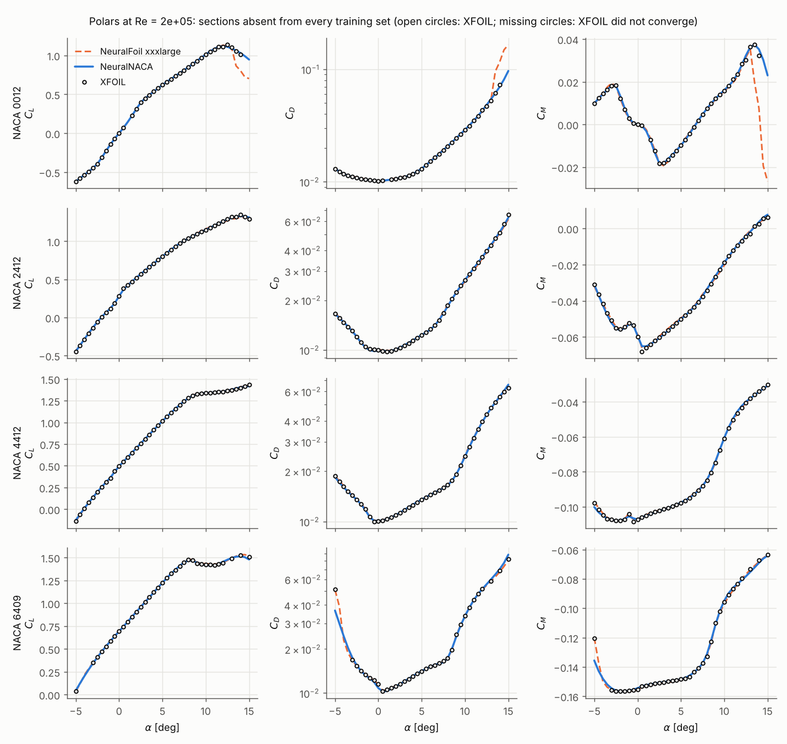
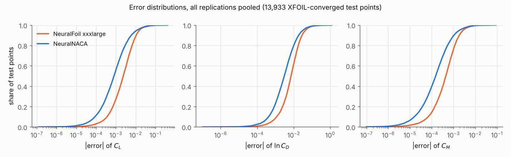
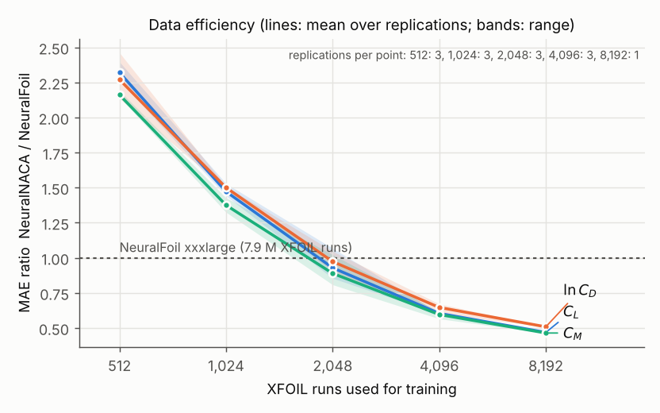
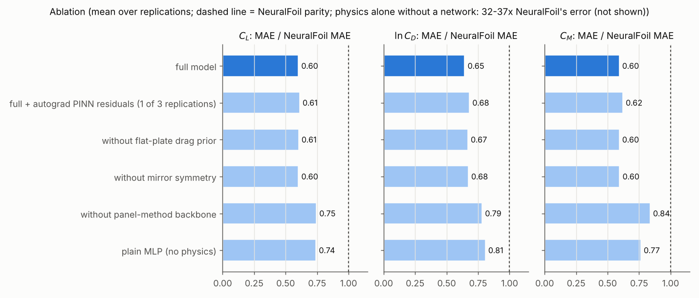

# Results

All tables on this page are generated from the files in `benchmarks/results/` (`neuralnaca report`), and all figures
with `neuralnaca figures`. The protocol is described in [Benchmark protocol](benchmark.md). The ratios in the prose
below are copied from those tables, and a test checks that they agree.

## Summary

1. **Lower mean error than NeuralFoil-xxxlarge for NACA sections, in every replication.** Pooled over five
   replications and 13,933 held-out test points, the MAE ratios NeuralNACA / NeuralFoil are 0.62 [0.58, 0.65] for
   \(C_L\), 0.65 [0.62, 0.68] for \(\ln C_D\) and 0.60 [0.57, 0.64] for \(C_M\). The interval excludes 1 for all three
   outputs in each replication, including the two generated after the code freeze, and against every NeuralFoil
   model size.
2. **The typical error is about 2.3-3x smaller** (medians), **but the largest errors are not smaller.** The RMSE
   ratios are 0.97 [0.82, 1.15] (\(C_L\)), 0.88 [0.80, 0.97] (\(\ln C_D\)) and 0.99 [0.82, 1.21] (\(C_M\)). Rare large
   errors in a sparsely sampled corner (high camber, low Re, negative incidence) offset the typical-case advantage
   for \(C_L\) and \(C_M\). See [Limitations](limitations.md#sparse-corners-with-sharp-physics-rare-but-large-errors).
3. **The main reason NeuralNACA wins is geometry.** NeuralFoil cannot represent a NACA section exactly; it analyses
   an 8+8-weight Kulfan fit of it. That fit is geometrically excellent, yet XFOIL's answer for the fitted shape differs
   from that for the exact section by about as much as NeuralFoil's entire error.
    * Scored against XFOIL on the fitted shape (what NeuralFoil actually analyses), NeuralFoil is *more* accurate than
      NeuralNACA is against XFOIL on the exact shape (ground-truth study below).
    * Even a plain MLP without any physics, trained on 4,096 exact-geometry XFOIL runs, beats NeuralFoil (ablation).
    * NeuralNACA is therefore the better tool *for NACA 4-digit sections*, because it models them exactly and
      specialises. It is not a better XFOIL emulator in general.
4. **The ground-truth protocol hardly matters; the geometry does.** Against XFOIL run with NeuralFoil's own
   warm-started sweep protocol on the exact geometry, the ratios are 0.61 [0.54, 0.67], 0.67 [0.61, 0.73] and
   0.62 [0.56, 0.68]. Against XFOIL on NeuralFoil's Kulfan geometry, NeuralFoil wins (e.g. 1.92 [1.73, 2.10] for
   \(C_L\), cold start).
5. **Of the physics ingredients, the panel-method backbone is what matters.** Removing it increases the MAE by
   21-41 %.
   Mirror symmetry and the drag prior change the MAE by at most 4 %; they guarantee consistency rather than accuracy.
   Autograd PINN residuals do not help and make training 4.5 times slower.
6. **Break-even with NeuralFoil is at about 2,000 XFOIL runs** (0.026 % of NeuralFoil's). With 8,192 runs (one
   replication) the error is about half of NeuralFoil's.
7. **Variability comes from the data, not the training.** Retraining on the same data with other seeds changes the
   MAE by about 1-2 % (standard deviation); across replications the ratio has a standard deviation of 0.03-0.06.
8. **The warning signals are informative but imperfect.** The support flag catches 36-47 % of the conditions where
   XFOIL fails and wrongly flags under 0.5 % of converged ones. The ensemble spread has a rank correlation of
   0.58-0.69 with the actual error.
9. **Speed is comparable to NeuralFoil** and about 40-1,400 times faster than XFOIL, depending on the batch shape.

## Polars of unseen sections

None of these sections is in any training set. Open circles are XFOIL; missing circles mean XFOIL did not converge.

At low Reynolds number the polars become strongly non-linear (laminar separation). Both surrogates follow XFOIL;
past stall of NACA 0012 they diverge from each other where XFOIL still converges.

## Error distributions

The cumulative distributions show where the advantage lies. NeuralNACA's curve is to the left (smaller errors) for
most points, and the two curves meet in the tail.

## Data efficiency and ablation

--8<-- "docs/results/tables.md"
